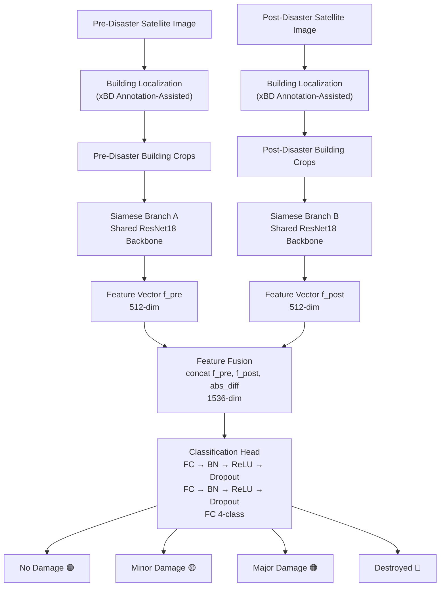

# DisasterVision 🛰️

> **AI-Powered Building Detection and Pre/Post-Disaster Damage Assessment using Siamese CNN**

[](https://python.org)
[](https://pytorch.org)
[](https://streamlit.io)
[](https://xview2.org)

---

## 📋 Project Overview

DisasterVision is an end-to-end Computer Vision system that:

1. Accepts **pre-disaster** and **post-disaster** satellite imagery of the same location
2. **Localizes individual buildings** using xBD ground-truth polygon annotations
3. **Extracts corresponding building crops** from both image pairs
4. **Classifies building-level damage** using a Siamese CNN trained on the xBD dataset
5. **Visualizes** per-building severity with colour-coded overlays

---

## 🌍 Problem Statement

When natural disasters occur — earthquakes, hurricanes, floods, wildfires — rapid and accurate damage assessment is critical for emergency response. Traditional satellite analysis is manual, slow, and inconsistent. DisasterVision automates building-level damage assessment by comparing pre and post-disaster satellite imagery, enabling first responders to prioritize resources effectively.

---

## 🏗️ System Architecture



---

## 📦 Dataset: xBD / xView2

| Property | Value |
|---|---|
| Name | xBD (xView2 Building Damage Assessment) |
| Source | [xview2.org](https://xview2.org) |
| Annotation | Building polygon + damage label per building |
| Disaster types | Earthquakes, fires, floods, hurricanes, tsunamis |
| Splits | Pre-disaster + post-disaster image pairs |
| Labels | `no-damage`, `minor-damage`, `major-damage`, `destroyed`, `un-classified` |

**Reference:** [xView2 Baseline GitHub](https://github.com/DIUx-xView/xView2_baseline)

> ⚠️ The xBD dataset requires registration at [xview2.org](https://xview2.org). The dataset is **not** included in this repository. See setup instructions below.

### xBD Directory Structure

```
xBD/
├── <disaster_event>/
│   ├── images/
│   │   ├── <tile>_pre_disaster.png
│   │   └── <tile>_post_disaster.png
│   └── labels/
│       ├── <tile>_pre_disaster.json
│       └── <tile>_post_disaster.json
```

---

## 🏢 Building Localization

| Mode | Description |
|---|---|
| **Annotation-Assisted** (current) | Building polygons extracted from xBD JSON annotations. Used for training, evaluation, and app demo with uploaded annotations. |
| **Automatic Detection** (future) | Planned integration of a pretrained segmentation model (e.g. SpaceNet SegFormer). Module interface is already modular (`inference/building_detector.py`). |

> **Important:** The current system uses **annotation-assisted localization**, not fully automatic building detection. The application clearly labels this in the UI. Ground-truth building polygons are used to extract crops for the Siamese CNN.

---

## 🧠 Siamese CNN Architecture

### Backbone: Shared ResNet18

Both branches of the Siamese network **share a single ResNet18 backbone** pretrained on ImageNet. Shared weights force the network to learn a common feature space for pre/post imagery.

```
Input (3×128×128)  →  ResNet18 (shared)  →  Flatten  →  512-dim feature vector
```

### Feature Fusion

```
f_pre   (512-dim)  ─┐
f_post  (512-dim)  ─┼─→  concat([f_pre, f_post, |f_pre − f_post|])  →  1536-dim
|f_pre−f_post| ───┘
```

The absolute difference captures visual change between pre and post images. Concatenation preserves individual building appearance in each temporal state.

### Classification Head

```
Linear(1536→512) → BN → ReLU → Dropout(0.4)
Linear(512→256)  → BN → ReLU → Dropout(0.2)
Linear(256→4)    → 4-class output (softmax at inference)
```

### Training Strategy

| Phase | Epochs | Backbone | LR |
|---|---|---|---|
| Phase 1 (warm-up) | 1–3 | Frozen | 1e-4 |
| Phase 2 (fine-tune) | 4+ | Unfrozen | 2e-5 |

- **Optimizer:** AdamW with weight decay 1e-5  
- **Loss:** CrossEntropyLoss with class frequency inverse weighting  
- **Sampler:** WeightedRandomSampler to handle class imbalance  
- **Scheduler:** CosineAnnealingLR  
- **Early Stopping:** patience = 4 epochs  

---

## 📁 Project Structure

```
DisasterVision/
│
├── data/
│   ├── raw/              ← xBD dataset (not committed to Git)
│   └── processed/        ← Extracted metadata cache
│
├── notebooks/
│   └── DisasterVision_Training.ipynb   ← Full Colab training notebook
│
├── preprocessing/
│   ├── annotation_parser.py    ← Parse xBD JSON annotations
│   ├── building_localization.py ← Annotation/auto localization module
│   ├── crop_extractor.py       ← Extract paired building crops
│   └── dataset_loader.py       ← PyTorch Dataset, DataLoader, splits
│
├── models/
│   └── siamese_cnn.py          ← Siamese ResNet18 architecture
│
├── training/
│   ├── train.py                ← Training entry point (local/Colab)
│   └── evaluate.py             ← Evaluation: metrics, plots, confusion matrix
│
├── inference/
│   ├── building_detector.py    ← Localization backend selector
│   └── damage_predictor.py     ← High-level prediction API
│
├── visualization/
│   └── damage_visualizer.py    ← Colour-coded overlay, building cards
│
├── outputs/                    ← Generated evaluation artifacts
│   ├── confusion_matrix.png
│   ├── training_curves.png
│   ├── class_distribution.png
│   ├── classification_report.txt
│   └── evaluation_metrics.json
│
├── checkpoints/                ← Model checkpoint (not in Git)
│   ├── best_model.pth
│   └── model_config.json
│
├── app.py                      ← Streamlit dashboard
├── config.py                   ← Central configuration
├── requirements.txt
├── README.md
└── .gitignore
```

---

## 🚀 Setup Instructions

### Prerequisites

- Python 3.10+
- Git
- (For training) Google Colab with GPU runtime

### 1. Clone the Repository

```powershell
git clone https://github.com/YOUR_USERNAME/DisasterVision.git
cd DisasterVision
```

### 2. Create Virtual Environment (Windows PowerShell)

```powershell
python -m venv venv
.\venv\Scripts\Activate.ps1
pip install -r requirements.txt
```

### 3. Configure xBD Dataset Path

Either:
- Set environment variable: `$env:XBD_ROOT = "C:\path\to\xBD"`  
- Or edit `config.py`: `DATASET_ROOT = Path("C:/path/to/xBD")`

---

## 🏋️ Google Colab Training

### Step 1: Open the Notebook

Upload `notebooks/DisasterVision_Training.ipynb` to Google Colab.  
Set runtime to **GPU** (Runtime → Change runtime type → T4 GPU).

### Step 2: Mount Google Drive

```python
from google.colab import drive
drive.mount('/content/drive')
```

Place your xBD dataset at:  
`/content/drive/MyDrive/xBD/`

### Step 3: Configure Paths (Cell 5 – Config)

```python
XBD_ROOT   = '/content/drive/MyDrive/xBD'
IMAGE_SIZE = 128
BATCH_SIZE = 32
NUM_EPOCHS = 10
```

### Step 4: Run All Cells

Execute all cells in sequence. Training will:
- Parse xBD annotations and extract building crops
- Train the Siamese CNN with early stopping
- Save `best_model.pth` to both `/content/` and Google Drive
- Generate confusion matrix, training curves, evaluation metrics

**Estimated training time:** 60–90 minutes on T4 GPU (depending on dataset size)

---

## 📥 Model Export

After training, the final Colab cell creates and downloads:

```
DisasterVision_Model_Export.zip
├── best_model.pth
├── model_config.json
├── class_mapping.json
├── preprocessing_config.json
├── evaluation_metrics.json
├── training_history.json
├── confusion_matrix.png
└── classification_report.txt
```

Download automatically:
```python
from google.colab import files
files.download('DisasterVision_Model_Export.zip')
```

Or retrieve from Google Drive:  
`My Drive / DisasterVision / DisasterVision_Model_Export.zip`

---

## 🖥️ Windows Local Deployment

### 1. Extract Model Export

```powershell
Expand-Archive DisasterVision_Model_Export.zip -DestinationPath .\checkpoints\
```

### 2. Run Streamlit App

```powershell
streamlit run app.py
```

The app automatically loads `checkpoints/best_model.pth`.

### 3. Using the App

1. **Upload** pre-disaster and post-disaster satellite image tiles
2. **Upload** corresponding xBD JSON annotation files (pre + post)
3. Click **🚀 Analyze Damage**
4. View per-building predictions, confidence scores, and damage map

---

## 📊 Model Evaluation

> *Actual metrics will be populated after training. The fields below are placeholders.*

| Metric | Value |
|---|---|
| Test Accuracy | To be filled after training |
| Macro F1 | To be filled after training |
| Weighted F1 | To be filled after training |
| Test Samples | Determined by dataset split |

Training hardware, duration, and actual per-class metrics are logged in  
`outputs/evaluation_metrics.json` and `outputs/classification_report.txt`  
after Colab training completes.

---

## ⚠️ Limitations

1. **Localization mode:** Current deployment uses annotation-assisted localization (xBD ground-truth polygons). Fully automatic building detection from arbitrary satellite images is not yet integrated.
2. **Dataset access:** xBD requires registration and manual download from [xview2.org](https://xview2.org).
3. **Image resolution:** Crops are resized to 128×128 for speed; higher resolutions (224×224) may improve accuracy at the cost of training time.
4. **Generalization:** The model is trained on xBD disasters only. Performance on out-of-distribution events may degrade.
5. **CPU inference:** Fully supported, but slower. GPU recommended for batch processing.

---

## 🔮 Future Improvements

- [ ] Integrate SpaceNet pretrained building segmentation for automatic detection
- [ ] Support 224×224 and larger crop sizes
- [ ] Add transformer-based backbone (ViT, Swin Transformer)
- [ ] Multi-scale feature extraction
- [ ] Temporal attention mechanism
- [ ] GIS export (GeoJSON damage reports)
- [ ] Multi-disaster event generalization study
- [ ] ONNX export for edge deployment

---

## 📚 References

- Gupta, R., Goodman, B., et al. (2019). *Creating xBD: A Dataset for Assessing Building Damage from Satellite Imagery.* CVPR 2019 Workshop.
- xView2 Baseline: https://github.com/DIUx-xView/xView2_baseline
- xBD Dataset: https://xview2.org
- SEI Project Page: https://www.sei.cmu.edu/projects/xview-2-challenge/

---

## 📄 License

This project is for research and educational purposes. The xBD dataset has its own licence — see [xview2.org/dataset](https://xview2.org/dataset) for terms.
